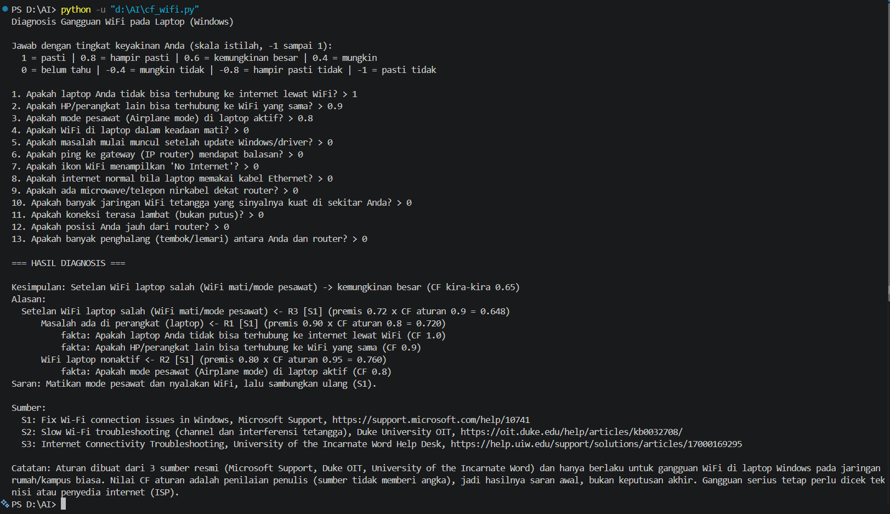
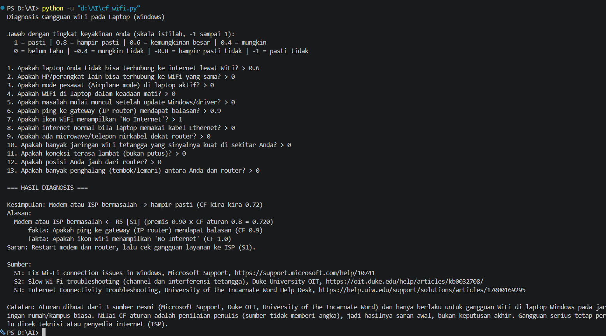
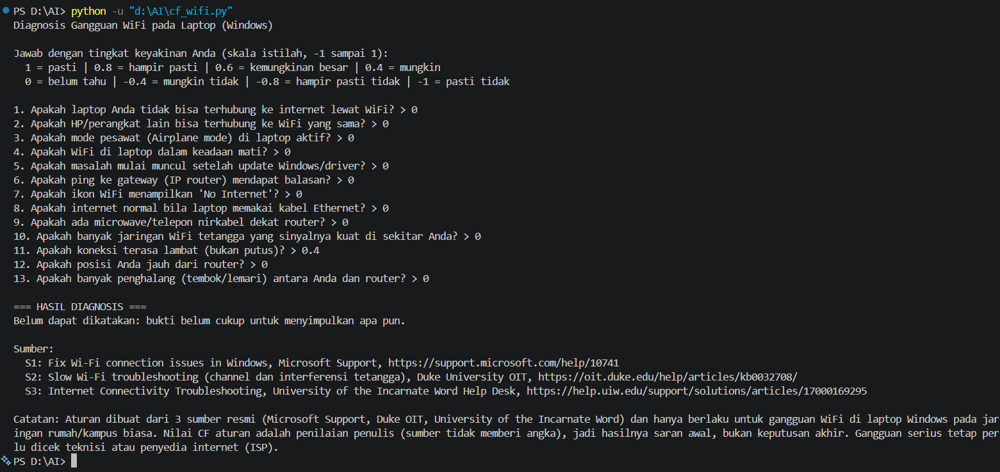

# Tugas 5 Kecerdasan Buatan: Sistem Pakar Gangguan WiFi (Certainty Factor)

## 1. Identitas
- Nama: **Rendy Wahyu Islami**
- NIM: **F1D02410133**

## 2. Topik dan Cara Menjalankan
Topik: diagnosis gangguan WiFi pada laptop Windows (WiFi mati/mode pesawat, driver, modem/ISP, router, interferensi sinyal).

- Bahasa: Python 3.8 ke atas, tanpa library tambahan.
- File: `kb_wifi.json` (basis aturan) dan `cf_wifi.py` (mesin inferensi CF).
- Perintah: `python cf_wifi.py`
- Program menanyakan 13 fakta. Pengguna bisa menjawab dengan skala istilah di bawah (angka -1 sampai 1).

| Istilah | CF |
|---|---|
| pasti | 1 |
| hampir pasti | 0.8 |
| kemungkinan besar | 0.6 |
| mungkin | 0.4 |
| belum tahu | 0 |
| mungkin tidak | -0.4 |
| hampir pasti tidak | -0.8 |
| pasti tidak | -1 |

## 3. Sumber dan Tabel Aturan
| Kode | Sumber |
|---|---|
| S1 | Fix Wi-Fi connection issues in Windows. Microsoft Support. https://support.microsoft.com/help/10741 |
| S2 | Slow Wi-Fi troubleshooting (channel dan interferensi tetangga). Duke University OIT. https://oit.duke.edu/help/articles/kb0032708/ |
| S3 | Internet Connectivity Troubleshooting. University of the Incarnate Word Help Desk. https://help.uiw.edu/support/solutions/articles/17000169295 |

| Aturan | IF | THEN | CF aturan | Sumber |
|---|---|---|---|---|
| R1 | laptop tak bisa konek AND perangkat lain bisa konek | perangkat bermasalah | 0.8 | S1 |
| R2 | mode pesawat aktif OR WiFi laptop mati | WiFi laptop nonaktif | 0.95 | S1 |
| R3 | perangkat bermasalah AND WiFi laptop nonaktif | **setelan WiFi salah** | 0.9 | S1 |
| R4 | perangkat bermasalah AND masalah setelah update | **driver adaptor bermasalah** | 0.7 | S1 |
| R5 | ping gateway berhasil AND tidak ada internet | **modem/ISP bermasalah** | 0.8 | S1 |
| R6 | laptop tak bisa konek AND Ethernet bisa internet | **router WiFi bermasalah** | 0.8 | S1 |
| R7 | dekat microwave/telepon nirkabel OR banyak WiFi tetangga | sinyal terganggu | 0.7 | S2, S3 |
| R8 | sinyal terganggu AND koneksi lambat | **interferensi sinyal** | 0.7 | S2, S3 |
| R9 | jauh dari router OR banyak penghalang | **interferensi sinyal** | 0.6 | S3 |

Ada 5 kesimpulan akhir. R3, R4 memakai hasil R1, R3 memakai hasil R2, dan R8 memakai hasil R7, jadi ada aturan yang memakai hasil aturan lain. Nilai CF aturan adalah penilaian penulis karena sumber tidak memberi angka.

## 4. Metode: Certainty Factor
Alasan memilih CF: gejala WiFi sering tidak pasti (misalnya "sepertinya lambat"), dan CF memungkinkan pengguna menjawab dengan tingkat keyakinan, tidak hanya ya/tidak.

Rumus:
1. Premis AND = **min** CF kondisi; premis OR = **max** CF kondisi.
2. CF hasil aturan = CF premis x CF aturan.
3. Dua aturan menyimpulkan hal yang sama: `CF gabungan = CF1 + CF2 x (1 - CF1)`.
4. Aturan hanya berlaku bila CF premis > 0. CF 0 berarti *belum diketahui* dan CF negatif berarti fakta ditolak, sehingga aturan tidak dijalankan (hasilnya 0, bukan angka negatif).
5. Penyampaian hasil: CF diterjemahkan ke kata (tabel di bawah), bukan persentase, karena CF bukan peluang. Kesimpulan dengan CF <= 0.2 tidak ditampilkan ("belum dapat dikatakan").

| CF hasil | Kata yang ditampilkan |
|---|---|
| 0.9 - 1.0 | pasti |
| 0.7 - 0.9 | hampir pasti |
| 0.5 - 0.7 | kemungkinan besar |
| 0.2 - 0.5 | mungkin |
| <= 0.2 | belum dapat dikatakan |

Langkah program: baca JSON, tanyakan fakta dasar, hitung CF semua hipotesis berulang sampai nilainya stabil (aturan berantai), lalu tampilkan kesimpulan akhir berurutan dari CF terbesar beserta aturan yang dipakai. Rumus penggabungan yang dipakai hanya kasus kedua CF positif, karena semua CF aturan dan semua premis yang berlaku bernilai positif.

**Perhitungan tangan** (kasus uji 1): laptop tak bisa konek = 1.0, perangkat lain bisa konek = 0.9, mode pesawat = 0.8, WiFi laptop mati = 0.
- R1: min(1.0, 0.9) = 0.9; 0.9 x 0.8 = **0.72** (perangkat bermasalah)
- R2: max(0.8, 0) = 0.8; 0.8 x 0.95 = **0.76** (WiFi laptop nonaktif)
- R3: min(0.72, 0.76) = 0.72; 0.72 x 0.9 = **0.648** (setelan WiFi salah)

Contoh penggabungan (kasus uji 4): R8 = 0.294 dan R9 = 0.42, maka CF = 0.294 + 0.42 x (1 - 0.294) = **0.591**.

## 5. Kasus Uji
| # | Jawaban | Hasil |
|---|---|---|
| 1 | laptop tak bisa konek 1, perangkat lain bisa konek 0.9, mode pesawat 0.8 | Setelan WiFi salah, kemungkinan besar (CF 0.648) |
| 2 | ping gateway 0.9, No Internet 1, laptop tak bisa konek 0.6 | Modem/ISP bermasalah, hampir pasti (CF 0.72) |
| 3 | koneksi lambat 0.4 saja | Belum dapat dikatakan (tidak ada kesimpulan) |
| 4 | microwave 0.6, koneksi lambat 0.8, jauh dari router 0.7 | Interferensi sinyal, kemungkinan besar (CF 0.591) |

## 5b. Uji Perubahan Gejala dan CF Aturan
Dasar: kasus uji 1 (laptop tak bisa konek 1, perangkat lain bisa konek 0.9, mode pesawat 0.8).

| Skenario | Hasil (CF) |
|---|---|
| A. Dasar | setelan WiFi salah 0.648 |
| B. Tambah gejala "masalah setelah update" = 0.6 | setelan WiFi salah 0.648; driver adaptor bermasalah 0.42 (muncul sebagai kesimpulan kedua) |
| C. Gejala update dinaikkan menjadi 1.0 | setelan WiFi salah 0.648; driver 0.504 (naik, karena R4 memakai min(0.72, 1.0) x 0.7) |
| D. Seperti C, tetapi CF aturan R3 diturunkan 0.9 menjadi 0.6 | driver 0.504 kini di atas setelan WiFi 0.432: urutan kesimpulan berbalik |

Satu gejala tambahan memunculkan kesimpulan baru, dan mengubah satu CF aturan dapat membalik urutan kesimpulan. Ini sifat CF sebagai ukuran keyakinan heuristik, sehingga pemilihan nilai CF aturan harus dijustifikasi (di sini berdasarkan penilaian penulis, lihat Bagian 6).

## 6. Batas Keberlakuan
Pengetahuan dalam sistem ini berasal dari tiga sumber resmi di atas (Microsoft Support, Duke OIT, UIW Help Desk) dan hanya untuk gangguan WiFi pada laptop Windows di jaringan rumah atau kampus biasa. Nilai CF aturan adalah penilaian penulis. Hasilnya berupa saran awal, bukan keputusan akhir; gangguan yang berlanjut sebaiknya dicek teknisi atau penyedia internet. Catatan ini juga ditampilkan oleh program.

## 7. Penggunaan Alat Bantu AI
Claude (Anthropic) saya gunakan untuk membantu mencari sumber dan menyusun draf aturan, draf kode, dan template README.
